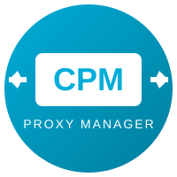
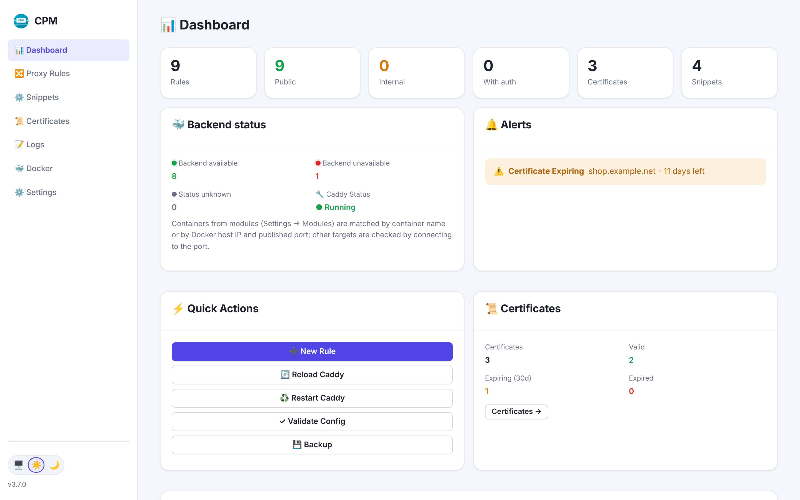
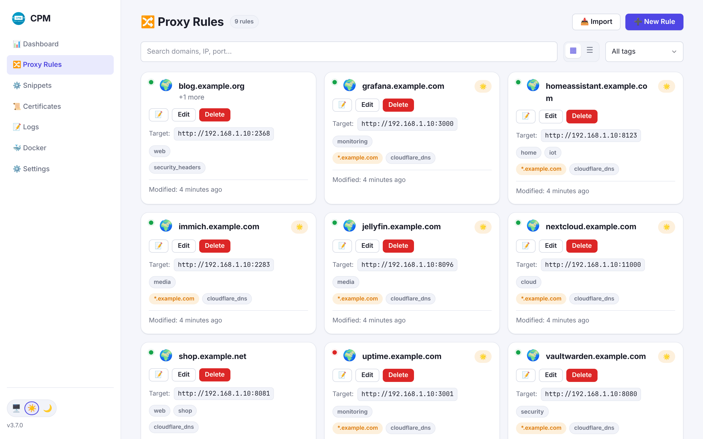
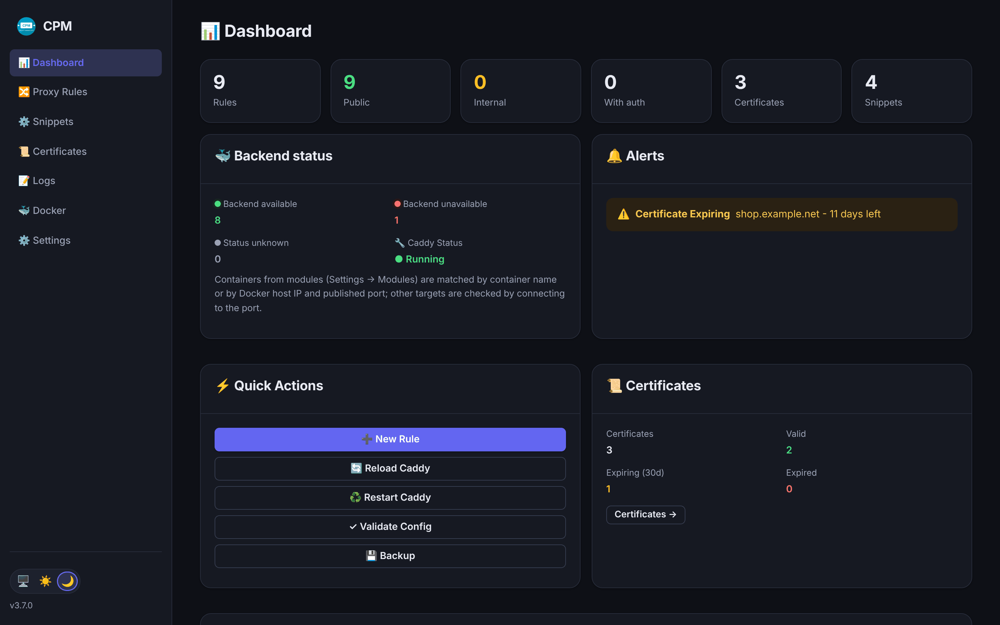

# CPM - Caddy Proxy Manager

<p align="center">
  
</p>

<p align="center">
  <strong>🚀 Lightweight web UI for managing Caddy reverse proxy</strong><br>
  Wildcard SSL • Docker Auto-Discovery • One-click rule creation
</p>

<p align="center">
  
  
  
  
</p>

---

## 📸 Screenshots

<p align="center">
  
  <br><em>Dashboard — backend status, alerts, certificates, quick actions</em>
</p>

<p align="center">
  
  <br><em>Proxy Rules — backend status, tags, wildcard certificates</em>
</p>

<p align="center">
  
  <br><em>Modern theme in dark mode</em>
</p>

<p align="center">
  📷 <a href="https://github.com/TomasZmek/cpm/tree/main/img"><strong>More screenshots</strong></a> — rule editor, certificates, Docker discovery, logs, settings; Modern and Classic themes
</p>

---

## ✨ Features

| Feature | Description |
|---------|-------------|
| 📊 **Dashboard** | System overview, stats, alerts, backend status (running / stopped / reachable), quick actions |
| 🔀 **Proxy Rules** | Visual editor for reverse proxy rules, container picker |
| 📥 **Caddyfile Import** | Import existing site blocks (lossless, with backup and rollback) |
| 🔐 **Wildcard SSL** | Manage wildcard certificates with DNS challenge |
| ⚙️ **Snippets** | Cloudflare DNS, security headers, rate limiting |
| 📜 **Certificates** | SSL overview with expiration warnings, bulk renewal |
| 📄 **Logs** | Access log of requests per rule (status, latency, client) with 24 h stats, plus parsed Caddy logs with level filter and search |
| 👥 **Multi-User** | Role-based access (Admin, Editor, Viewer) |
| 💾 **Backup** | Full config backup & restore |
| 🏠 **Internal-only** | Restrict sites to internal network only |
| 🎨 **Themes** | Classic or Modern (light/dark, accent colours); works on phones and tablets |
| 🌐 **i18n** | English, Czech & Korean |
| 📋 **Templates** | 17+ pre-configured service templates |
| 🐳 **Docker Auto-Discovery** | Containers per Docker host, paired with rules by host IP + published port, one-click rule creation |
| 🧩 **Modules** | Extend CPM from the admin UI: Docker (local) and **Dockhand** (containers on all your Docker hosts) |

---

## 🚀 Quick Start

```bash
docker pull perteus/caddy-ui:latest
docker pull perteus/caddy-ui:3.7.0
```

### Docker Compose

```yaml
version: '3.8'
services:
  caddy:
    image: serfriz/caddy-cloudflare:latest
    container_name: caddy_proxy
    environment:
      - CF_API_TOKEN=${CF_API_TOKEN}
    ports:
      - "80:80"
      - "443:443"
    volumes:
      - ./caddy-config:/etc/caddy
      - ./caddy-data:/data

  cpm:
    image: perteus/caddy-ui:3.7.0
    container_name: cpm
    ports:
      - "8501:8501"
    environment:
      - CONTAINER_NAME=caddy_proxy
      - DEFAULT_IP=192.168.1.100
    volumes:
      - ./caddy-config:/caddy-config
      - ./caddy-data:/caddy-data
      - /var/run/docker.sock:/var/run/docker.sock
```

### Synology NAS

On Synology add `privileged: true` for Docker socket access.

```yaml
cpm:
  image: perteus/caddy-ui:3.7.0
  privileged: true
  volumes:
    - /volume1/docker/caddy-config:/caddy-config
    - /volume1/docker/caddy-data:/caddy-data
    - /var/run/docker.sock:/var/run/docker.sock
```

---

## ⚙️ Environment Variables

| Variable | Default | Description |
|----------|---------|-------------|
| `PORT` | `8501` | HTTP port |
| `CONTAINER_NAME` | `caddy` | Caddy container name |
| `DEFAULT_IP` | `192.168.1.1` | Default target IP |
| `THEME` | `classic` | Default UI theme (`classic` or `modern`) |
| `TRUSTED_PROXIES` | `private,loopback` | Reverse proxies whose `X-Forwarded-*` headers are trusted (`none` to disable) |
| `TRUSTED_ORIGINS` | - | Extra origins allowed to submit forms, e.g. `https://cpm.example.com` |
| `CF_API_TOKEN` | - | Cloudflare API token (for wildcard SSL) |

---

## 📝 Version History

| Version | Notes |
|---------|-------|
| **3.7.0** | 📝 Access log per rule — requests, status and response times for each rule; Fiber v3 |
| **3.6.0** | ⚓ Dockhand module — backend status and discovery for containers on all Docker hosts |
| **3.5.1** | 🔒 Security patch — Go 1.26.10, fasthttp, compress, x/crypto (31 known vulnerabilities fixed) |
| **3.5.0** | 🧩 Modules, backend status for IP rules, discovery per host, host IP detection fix |
| **3.4.1** | 🔐 Certificate backups & restore, renewal that really renews, Restart Caddy button |
| **3.4.0** | 🎨 Modern theme, Caddyfile import, logs viewer, mobile layout, role enforcement & security hardening |
| **3.3.1** | 🔒 Security patch — Go 1.26.4 (CVE-2026-42504, CVE-2026-27145, CVE-2026-42507) |
| **3.3.0** | 🌐 i18n refactor — PO/MO format, Korean language, plural support infrastructure |
| **3.2.0** | 🐳 Docker Auto-Discovery — automatic container detection, multi-host support |
| **3.1.3** | 🔒 Security patch — CVE fixes, moved to moby/moby/client |
| **3.1.2** | 🔒 Security fixes, CSRF, race condition, path traversal |
| **3.1.1** | 🔐 Internal-only restrictions, Go 1.26, multi-platform (amd64/arm64) |
| **3.1.0** | 🔐 Wildcard refactor, new architecture |
| **3.0.2** | 🐛 Wildcard TLS fix, parser fix, 405 fix |
| **3.0.1** | 🔐 Wildcard SSL, migration tools, UI improvements |
| **3.0.0** | 🎉 Complete Go rewrite (794MB → 6MB) |
| 2.x | Python version (deprecated) |

### v3.7.0 - Access log per rule
- ✅ **Access log** — turn it on in Settings → Logs; Caddy writes every request to `/data/cpm-logs/access.log` (Caddy data volume, no compose change), rotated by size, optional IP masking
- ✅ **Logs → Requests** — requests per rule with status, response time, size and client, filters and 24 h stats; 📝 on each rule opens its requests
- ✅ **Do not log** a rule or selected paths (e.g. `/health*`), works for wildcard rules too
- 🔧 **Fiber v3**, CSRF that works behind Caddy (`TRUSTED_PROXIES` / `TRUSTED_ORIGINS`), flash messages in any language
- 🐛 Rules search and tag filter, "Download backup", password-change message, return to the previous page on a non-standard port

### v3.6.0 - Dockhand module
- ✅ **Dockhand module** — reads containers of all environments managed by [Dockhand](https://dockhand.pro) (local host and remote hosts via Hawser), so backend status and Docker discovery cover every machine
- ✅ Host IP per environment from Dockhand's *Public IP* (or `ID=IP` in the module settings)
- ✅ Containers reported by several modules are shown once
- 🧪 Test builds of the develop branch: `perteus/caddy-ui:develop` (never `latest`)

### v3.5.0 - Modules & backend status
- ✅ **Modules** — enable, configure and disable extensions in Settings → Modules; settings live in `caddy-config/modules.json` ([docs/modules.md](https://github.com/TomasZmek/cpm/blob/main/docs/modules.md))
- ✅ **Backend status that works with IP rules** — `192.168.1.10:8080` is matched to the container publishing port 8080 on that host; other targets are checked by connecting to the port
- ✅ **Docker discovery per host** — containers are listed under the host they run on, rules are created with host IP + published port
- 🐛 **Host IP detection** no longer returns the container's own address (172.x)
- ⚠️ After upgrading, set the **Docker host IP** in Settings → Modules → Docker (local)

### v3.4.1 - Certificate backups & Restart Caddy
- ✅ **Certificate backups** — Renew/Delete move certificates to a backup instead of deleting them; restore from the Certificates page
- ✅ **Renewal that really renews** — Caddy is restarted (a reload kept serving the old certificate from memory)
- ✅ **Restart Caddy** button on the dashboard, with config validation first
- 📦 Offline packages (amd64/arm64) and `ghcr.io/tomaszmek/cpm` multi-arch image on [GitHub Releases](https://github.com/TomasZmek/cpm/releases)

### v3.4.0 - Modern theme, Caddyfile import & security hardening
- ✅ **Modern theme** — optional redesign with light/dark mode and accent colours (Classic stays default)
- ✅ **Caddyfile import** — lossless import of existing site blocks with backup and rollback
- ✅ **Logs viewer, bulk certificate renewal, backend status, container picker**
- ✅ **Phones & tablets** — off-canvas menu, list–detail settings
- ✅ **Security** — roles enforced, API requires login + CSRF, import/restore path checks
- ⚠️ **Upgrade notes** — API scripts must log in; new passwords need 8+ characters
- 📋 Full notes: [RELEASE_NOTES.md](https://github.com/TomasZmek/cpm/blob/main/RELEASE_NOTES.md)

---

### v3.2.0 - Docker Auto-Discovery
- ✅ **Auto-Discovery** — automatic detection of running containers
- ✅ **Multi-host support** — monitor multiple Docker hosts
- ✅ **Smart pairing** — match existing proxy rules with containers
- ✅ **One-click rule creation** — pre-filled from discovered containers
- ✅ **Local IP autodetection** — detects host IP automatically

---

### v3.1.3 - Security Patch
- ✅ **CVE fixes** — bump golang.org/x/crypto 0.45.0 → 0.52.0
- ✅ **Docker SDK migration** — github.com/docker/docker → github.com/moby/moby/client (permanent fix)
- ✅ **Multi-platform** — native amd64 + arm64

---

## 🧩 Modules

Enable and configure extensions in **Settings → Modules** — no restart, settings are stored in `caddy-config/modules.json`.

| Module | What it does |
|--------|--------------|
| 🐳 **Docker (local)** | Containers from the mounted Docker socket. Set **Docker host IP** to your NAS address. |
| ⚓ **Dockhand** | Containers of all [Dockhand](https://dockhand.pro) environments (local and remote hosts via Hawser). Dockhand URL + API token; host IPs from each environment's *Public IP*. |

CPM then shows for every proxy rule whether its backend container is running (with container name and host), or whether the target port responds. Docs: [docs/modules.md](https://github.com/TomasZmek/cpm/blob/main/docs/modules.md)

---

## 🧪 Test builds

`perteus/caddy-ui:develop` (newest) and `perteus/caddy-ui:develop-<commit>` are built from the development branch on every change — for testing only, never tagged `latest`.

---

## 🔗 Links

- 📦 **Source Code**: [github.com/TomasZmek/cpm](https://github.com/TomasZmek/cpm)
- 🐛 **Report Bugs**: [GitHub Issues](https://github.com/TomasZmek/cpm/issues)
- 💡 **Feature Requests**: [GitHub Discussions](https://github.com/TomasZmek/cpm/discussions)

---

## 🙏 Acknowledgments

- 🇰🇷 Korean translation, Modern theme and Caddyfile import: [@redstar-programmer](https://github.com/redstar-programmer)

---

## 📄 License

MIT License

---

<p align="center">
  <strong>CPM - Caddy Proxy Manager</strong><br>
  Made with ❤️ for home labs
</p>
